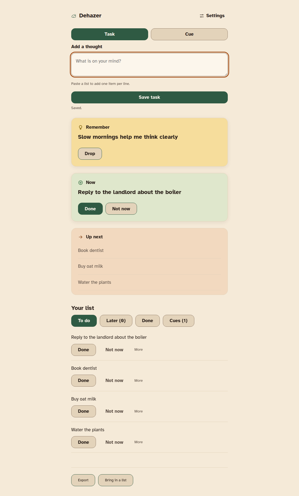
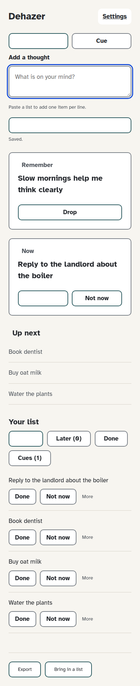
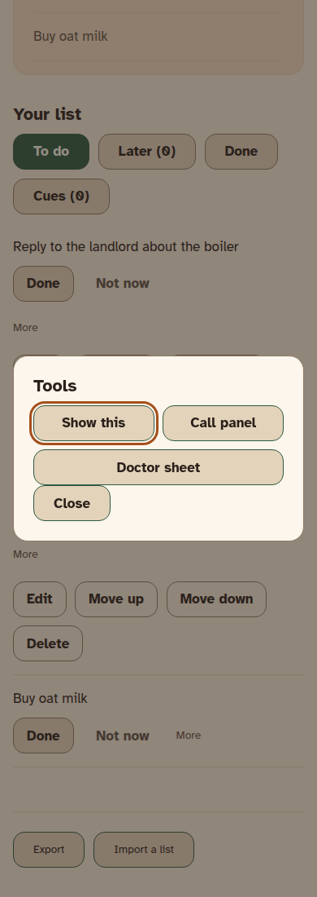
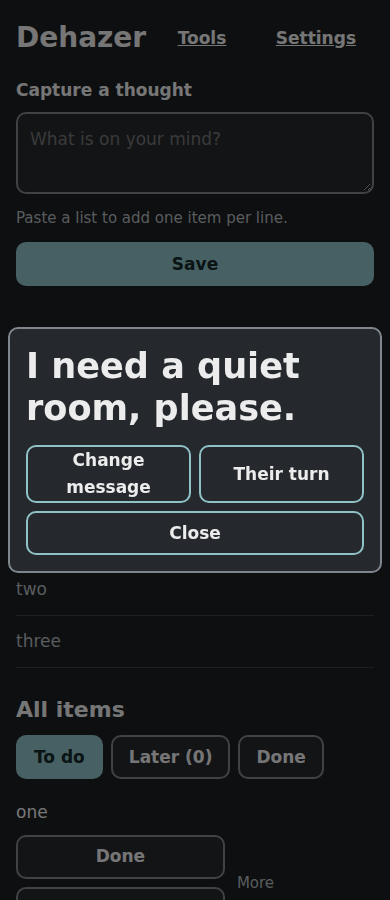
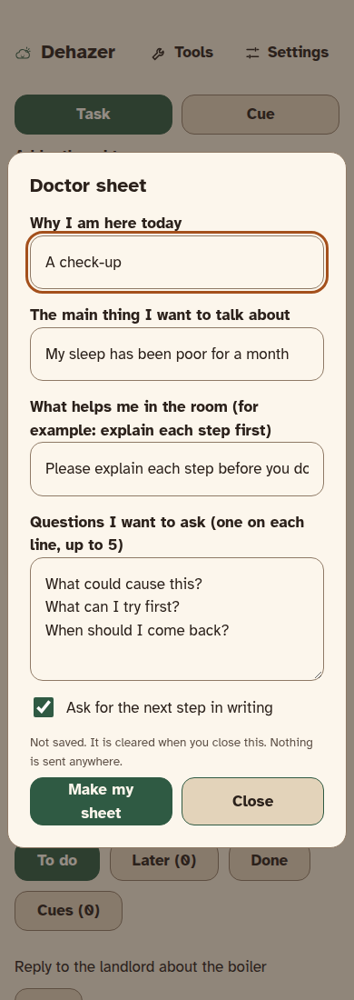
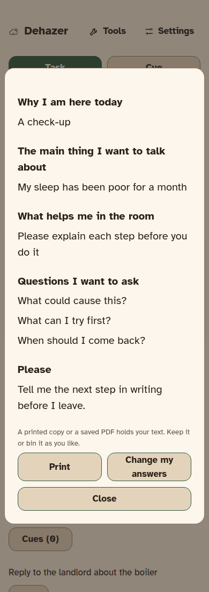
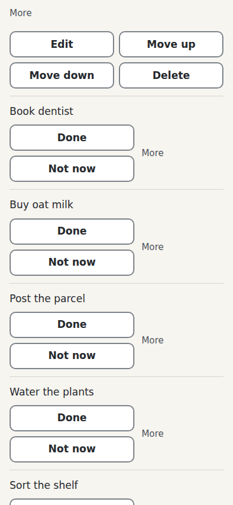

# Dehazer

A free, open-source, local-first web app that helps ADHD and autistic adults **capture** a thought, **remember** it and **act** on it.

**Status: early.** Capture, two kinds of memo (tasks and cues), a Now card, Up next, Later, edit, move up and down, Settings, Markdown export and import, and offline use work in the browser. See [docs/DESIGN.md](docs/DESIGN.md) and [docs/UX-DECISIONS.md](docs/UX-DECISIONS.md).

## Two kinds of memo
- **Task:** goes straight to the list. One task shows in the Now card. The next four wait in Up next.
- **Cue:** something to remember, like a reason or a fact you like. One cue at a time shows in its own card. It comes back on days 1, 3, 7, 14 and 30, then every month. The only action is Drop, with 30 seconds to undo.
- **Look:** Honey and pine is the default: oat page, ivory cards, pine buttons. The v0.6 warm look (kept for one release) and a Plain look are in Settings. There is no motion and no sound in any look.

## Screenshots

## Three promises
1. No account, no app backend, no tracking. Your data stays on your device.
2. Nothing moves, flashes or shames. The layout is the same every day.
3. Your data is yours. One tap exports plain Markdown.

## What it is not
- Not a treatment. It makes no health claims.
- Not a cloud service.
- Not a place for streaks, overdue counters or guilt.

## How the project works
- Rules for everyone: [MODUS_OPERANDI.md](MODUS_OPERANDI.md)
- How to help (code and non-code): [CONTRIBUTING.md](CONTRIBUTING.md)
- Layout and motion rules: [LAYOUT-FREEZE.md](LAYOUT-FREEZE.md)
- Research behind the design: [docs/RESEARCH.md](docs/RESEARCH.md)
- What is built, what waits, and why: [docs/UX-DECISIONS.md](docs/UX-DECISIONS.md), [BACKLOG.md](BACKLOG.md)
- Access notes: [docs/ACCESSIBILITY.md](docs/ACCESSIBILITY.md)
- Font: Atkinson Hyperlegible, SIL Open Font Licence ([fonts/OFL-LICENSE.txt](fonts/OFL-LICENSE.txt))

## Licence
MIT. See [LICENSE](LICENSE).

## Export and import format
Export writes plain Markdown, one item per line:

    - [ ] buy bread <!-- id -->
    - [ ] call back <!-- id later -->
    - [x] book dentist <!-- id -->
    - [ ] slow mornings help me think <!-- id cue -->

The first lines hold `<!-- dehazer-export v1 -->`. The `later` and `cue` tags are read only from these files too. Cue schedules are not saved: an imported cue starts again at day 1. Import reads ids only from files that carry it, so importing the same backup twice adds nothing. Any other Markdown checklist imports as new items. Line breaks in an item become spaces.
