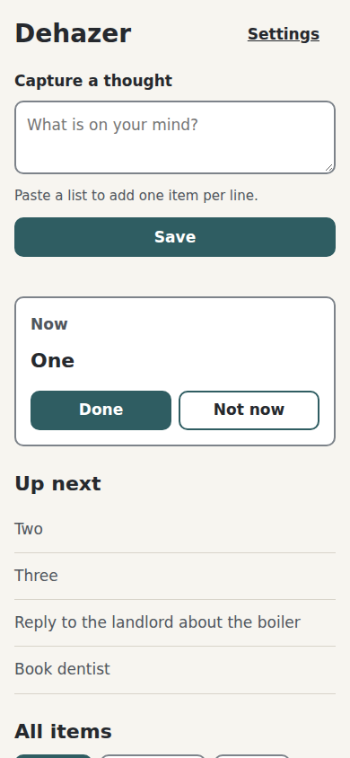
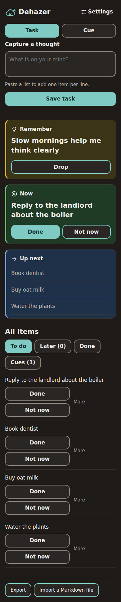
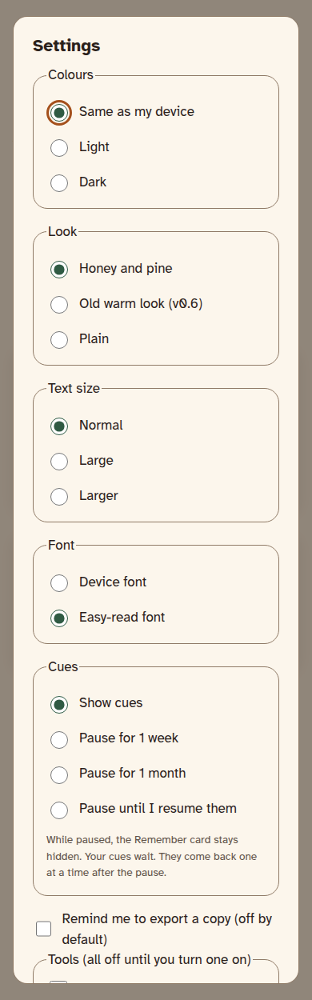
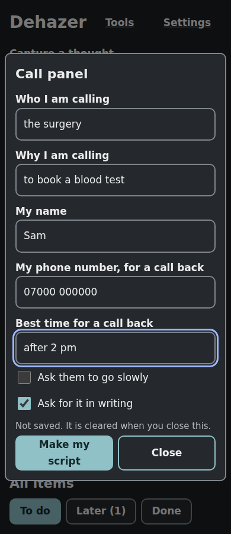
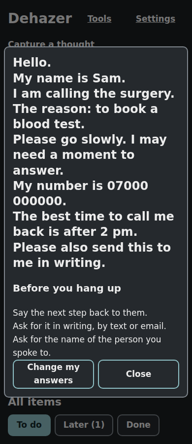

# Dehazer

A free, open-source, local-first web app that helps ADHD and autistic adults **capture** a thought, **remember** it and **act** on it.

**Status: early.** Capture, a Now card, Up next, Later, edit, move up and down, Settings, Markdown export and import, and offline use work in the browser. See [docs/DESIGN.md](docs/DESIGN.md) and [docs/UX-DECISIONS.md](docs/UX-DECISIONS.md).

## Screenshots

## Three promises
1. No account, no app backend, no tracking. Your data stays on your device.
2. Nothing moves, flashes or shames. The layout is the same every day.
3. Your data is yours. One tap exports plain Markdown.

## What it is not
- Not a treatment. It makes no health claims.
- Not a cloud service.
- Not a place for streaks, overdue counters or guilt.

## How the project works
- Rules for everyone: [MODUS_OPERANDI.md](MODUS_OPERANDI.md)
- How to help (code and non-code): [CONTRIBUTING.md](CONTRIBUTING.md)
- Layout and motion rules: [LAYOUT-FREEZE.md](LAYOUT-FREEZE.md)
- Research behind the design: [docs/RESEARCH.md](docs/RESEARCH.md)
- What is built, what waits, and why: [docs/UX-DECISIONS.md](docs/UX-DECISIONS.md), [BACKLOG.md](BACKLOG.md)
- Access notes: [docs/ACCESSIBILITY.md](docs/ACCESSIBILITY.md)
- Font: Atkinson Hyperlegible, SIL Open Font Licence ([fonts/OFL-LICENSE.txt](fonts/OFL-LICENSE.txt))

## Licence
MIT. See [LICENSE](LICENSE).

## Export and import format
Export writes plain Markdown, one item per line:

    - [ ] buy bread <!-- id -->
    - [ ] call back <!-- id later -->
    - [x] book dentist <!-- id -->

The first lines hold `<!-- dehazer-export v1 -->`. Import reads ids only from files that carry it, so importing the same backup twice adds nothing. Any other Markdown checklist imports as new items. Line breaks in an item become spaces.
